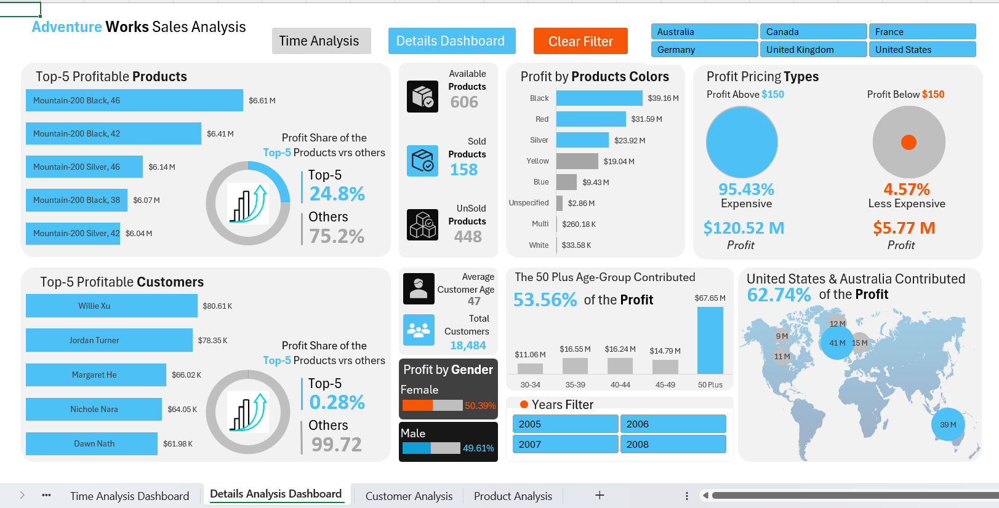
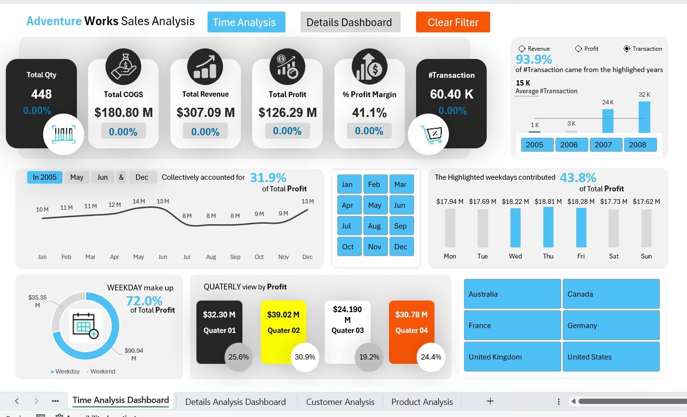
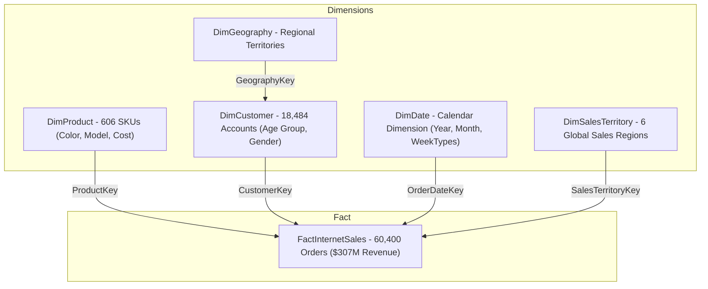

# 🛒 Global Retail Sales & Profit Intelligence Dashboard (AdventureWorks DW)
### Enterprise Relational Data Modeling & Financial BI in Microsoft Excel | Power Query • Power Pivot • DAX • Star Schema

[](https://www.microsoft.com/en-us/microsoft-365/excel)
[](https://support.microsoft.com/en-us/office/power-pivot-overview-and-learning-f3cacf4b-7e18-4e8c-8e39-2a91289196b0)
[](https://learn.microsoft.com/en-us/dax/)
[]()
[]()

---

## 📌 Executive Summary
In global retail and e-commerce enterprises, managing multi-tier product catalogs, monitoring gross profit margins, and identifying inventory deadweight are essential for maintaining healthy cash flows and capital efficiency. Traditional spreadsheet reporting often relies on slow, denormalized flat sheets with fragile `VLOOKUP` formulas that cause workbook crashes and severe maintenance overhead.

This project delivers an enterprise-grade **Global Retail Sales & Profitability Intelligence Solution** built entirely inside **Microsoft Excel using Power Query, Power Pivot, and DAX**. Analyzing **60,400 sales transactions generating $307.09M in revenue and $126.29M in profit (41.1% margin)** across 18,484 customers, this system uncovered that **448 of 606 catalog products (73.9%) were completely unsold dead inventory**, while the **50+ age cohort drove 53.56% ($67.65M) of total enterprise profit**.

---

## 🖥️ Executive Dashboard Previews

### 1️⃣ Time Analysis Dashboard


### 2️⃣ Details Analysis & Deep-Dive Dashboard


---

## 🎯 Business Problem & Core Objectives
1. **Relational Enterprise Modeling:** Avoid denormalized single-sheet data dumping by building a clean star-schema relational model with one-to-many relationships inside Power Pivot.
2. **Catalog & Inventory Diagnostic:** Audit catalog performance to distinguish active revenue-generating SKUs from stagnant dead inventory.
3. **Temporal & Seasonal Profitability:** Analyze profit volatility across years, quarters, months, and weekday vs. weekend shopping cycles.
4. **Demographic & Pricing Sensitivity:** Uncover customer age concentration, gender profit splits, and high-ticket (> $150) price elasticity.
5. **C-Suite Interactive Presentation:** Design a two-page executive dashboard (Time Analysis & Details Analysis) with KPI cards, slicers, dynamic narrative callouts, and button navigation.

---

## 📊 Core Financial & Retail KPI Snapshot

| Metric Category | Key Performance Indicator (KPI) | Portfolio Result | Business Context / Finding |
| :--- | :--- | :--- | :--- |
| **Sales Scale** | Total Transactions (#Transaction) | **60,400 orders** | Complete multi-year transactional ledger |
| **Gross Volume** | Total Revenue | **$307,090,000.00** | Net sales volume across 6 global markets |
| **Cost Exposure** | Cost of Goods Sold (COGS) | **$180,800,000.00** | Direct product inventory manufacturing cost |
| **Bottom-Line** | Total Profit | **$126,290,000.00** | Gross operating profit |
| **Margin Health** | Profit Margin % | **41.1%** | Solid retail profit margin |
| **Order Scale** | Total Order Quantity | **631,920 units** | Total physical units shipped |
| **Catalog Health** | Total Catalog Products | **606 items** | Full active catalog |
| **Active SKUs** | Sold Products | **158 products (26.1%)** | Active revenue drivers |
| **Dead Stock** | **Unsold Products (Dead Inventory)** | **448 products (73.9%)** | ⚠️ Severe inventory capital lockup |
| **Customer Scale**| Total Active Customers | **18,484 accounts** | Average customer age: 47 years |
| **Key Demographic**| **50+ Age Group Profit Contribution** | **53.56% ($67.65M)** | 🎯 Primary high-margin customer persona |
| **Top Territories**| **United States & Australia** | **62.74% of Profit** | US ($41M) and Australia ($39M) dominant |
| **Pricing Skew** | **Expensive Products (> $150)** | **95.43% ($120.52M)** | Luxury/high-ticket equipment dependency |

---

## 🏗️ Data Architecture & Power Pivot Star Schema

The analytical model was engineered inside **Excel's Power Pivot xVelocity In-Memory Engine**:



### Data Modeling Highlights:
- **Zero Denormalization:** Preserved clean relational normalization; zero `VLOOKUP` or `XLOOKUP` formulas in worksheets.
- **Dedicated All Measures Table:** Created an independent calculation container storing all DAX business measures for clean model governance.
- **Power Query Custom Features:** Extracted custom columns for `Total Revenue`, `Cost of Good Sold (COGS)`, `Total Profit`, `Product Price Type`, `WeekTypes`, and `Age-Group`.

---

## 🛠️ Advanced DAX Formulations & Formulas

### 1. Catalog Dead Stock / Unsold Products Measure
```dax
All Products = COUNTROWS(DimProduct)

Sold Products = DISTINCTCOUNT(FactInternetSales[ProductKey])

Unsold Products = [All Products] - [Sold Products]
```

### 2. Profit Margin Percentage (Safe Divide)
```dax
% Profit Margin = DIVIDE([Total Profit], [Total Revenue], 0)
```

### 3. Customer Base Quantification
```dax
# Customers = DISTINCTCOUNT(FactInternetSales[CustomerKey])
```

---

## 📈 Dashboard Architecture & Visual Walkthrough

*(Screenshots captured from live implementation in Microsoft Excel)*

### 1. Dashboard 1 — Time Analysis View
- **Top Executive Ribbon:** 3D Neumorphic KPI cards featuring Total Qty (448), Total COGS ($180.80M), Total Revenue ($307.09M), Total Profit ($126.29M), Profit Margin (41.1%), and #Transactions (60.40K).
- **Monthly Spline Trend:** Monthly profit line showing summer and holiday surges (*In 2005 May, Jun & Dec collectively accounted for 31.9% of Total Profit*).
- **Weekday vs. Weekend Donut:** Weekdays contribute **72.0% ($90.94M)** vs. Weekend **28.0% ($35.35M)**.
- **Quarterly Cards:** Q1 ($32.30M), Q2 ($39.02M - Yellow highlight), Q3 ($24.19M), and Q4 ($30.78M).


---

### 2. Dashboard 2 — Details Analysis View
- **Top-5 Profitable Products:** Mountain-200 variants driving **24.8% of product profit** ($31.27M).
- **Color Profitability:** Black ($39.16M), Red ($31.59M), and Silver ($23.92M) leading.
- **Product Pricing Types:** Expensive (> $150) generating **95.43% ($120.52M)** of profit vs. Budget items ($5.77M).
- **Demographic Breakdown:** 50+ age cohort driving **53.56% ($67.65M)** of total profit; female (50.39%) vs male (49.61%) parity.
- **Geographic Concentration:** US and Australia driving **62.74% of total profit**.


---

## 💡 Key Business & Operational Insights
1. **The Dead Stock Crisis (73.9% Unsold):** Out of 606 catalog products, **448 items recorded zero historical sales**. The business is incurring massive warehouse holding costs on dead inventory.
2. **The 50+ Age Demographic Goldmine:** While sports marketing traditionally targets youth, customers aged **50 and older contributed over half of total profit (53.56%)**, driven by disposable income for high-end cycling.
3. **Mid-Week Purchasing Dominance:** Weekdays account for **72.0% of total profit** ($90.94M), with Thursday ($18.81M) and Wednesday ($18.22M) leading as peak ordering days.
4. **Extreme Price-Tier Reliance:** 95.43% of profits are generated by items priced above $150. Low-cost accessories contribute negligible bottom-line value.

---

## 🎯 Strategic Business Recommendations
- **Catalog Rationalization & Dead Stock Clearance:** Liquidate the 448 unsold products through bundled discount promotions and de-list chronic non-performers to free up capital.
- **Targeted Marketing to Mature Affluent Cohorts:** Direct digital ad spend toward professionals aged 45–60 highlighting ergonomics, endurance, and premium engineering.
- **Supply Chain Focus on Top 3 Colors:** Streamline manufacturing around Black, Red, and Silver frames while reducing inventory holding in slow-moving multi/white colors.
- **Weekday Flash Promotions:** Launch targeted corporate email campaigns on Tuesday–Thursday mornings to capture the 72% weekday purchasing traffic.

---

## 📂 Repository Structure
```text
adventure-works-sales-profit-excel/
│
├── Adventure_Excel_Dashboard.xlsm                               # Interactive Excel dashboard with Power Pivot & in-memory DAX model
├── Adventure_Works_Sales_Profit_Analysis_Professional_Report_v2.docx # In-depth 20+ page executive business report & KPI documentation
│
├── data_architecture_pipeline.png                               # Power Pivot In-Memory xVelocity Dimensional Architecture
├── dashboard_time_analysis.png                                  # View 1: Time Analysis Dashboard ($307M Revenue & Seasonal Trends)
├── dashboard_details_view.png                                   # View 2: Details Analysis Dashboard (50+ Age Cohort & Product Profitability)
│
├── requirements.txt                                             # Software prerequisites & Excel Power Pivot specifications
├── .gitignore                                                   # Ignores Excel lock files (~$*) and temporary caches
└── README.md                                                    # Master project pitch deck & executive summary
```

---

## 🚀 How to Run & Replicate
1. **Clone the Repository:**
   ```bash
   git clone https://github.com/ravinder0710/adventure-works-sales-profit-excel.git
   cd adventure-works-sales-profit-excel
   ```
2. **Open the Excel Dashboard:**
   - Launch **Microsoft Excel 2019 / 2021 / Microsoft 365** (64-bit recommended).
   - Ensure **Power Pivot** is enabled (`File > Options > Add-ins > COM Add-ins > Microsoft Power Pivot for Excel`).
   - Open `/dashboard/Adventure_Works_Sales_Analysis.xlsx`.
3. **Explore Interactivity:**
   - Use the **[Time Analysis]** and **[Details Dashboard]** buttons to toggle views.
   - Use the **[Clear Filter]** button to reset slicers.

---

## 👨‍💼 Author & Contact
**Ravinder Gupta**  
*Data Analyst | Business Intelligence & Advanced Excel Specialist*  
- 📍 **Location:** Gurugram (Delhi-NCR), India  
- 📧 **Email:** [iamravindergupta17@gmail.com](mailto:iamravindergupta17@gmail.com)  
- 🐙 **GitHub:** [github.com/ravinder0710](https://github.com/ravinder0710)
